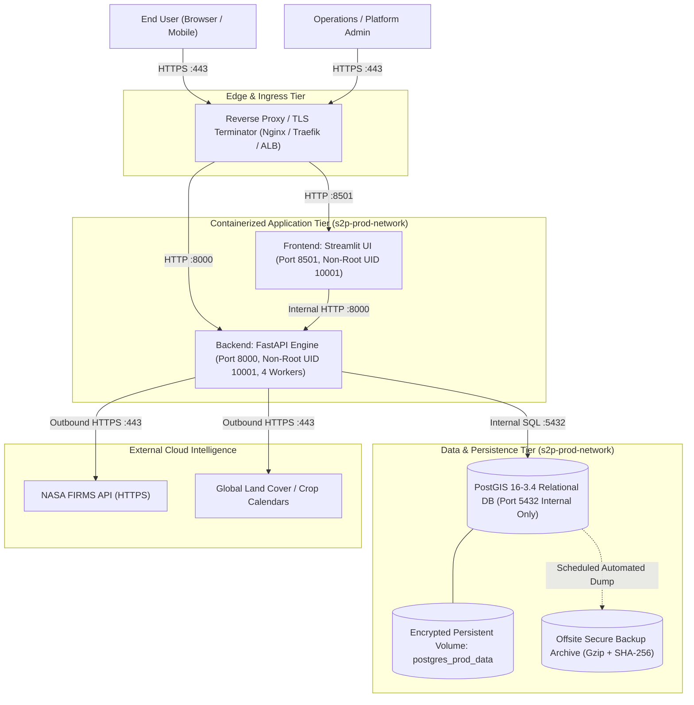

# Stubble2Power — Production Deployment Architecture

**Document ID:** S2P-DOC-DEP-ARCH-2026-V1  
**Classification:** Infrastructure & DevOps Architecture  
**Platform Version:** v2.5.0  

---

## 1. System Topology Overview

Stubble2Power is deployed as a containerized, decoupled microservice topology designed for high availability, zero-trust network segregation, and non-root execution.

---

## 2. Container Network Isolation & Security Perimeter

1. **Bridge Network Isolation:**
   All production containers operate within a private, dedicated bridge network (`s2p-prod-network`). Direct external communication is restricted to authorized ingress paths.
2. **Zero Host Exposure for Database:**
   In `docker-compose.prod.yml`, the PostgreSQL/PostGIS database exposes port `5432` **strictly within the Docker network**. No host port binding (`ports: - "5432:5432"`) is permitted.
3. **Unprivileged Container Execution:**
   Both the FastAPI backend and Streamlit frontend execute under an unprivileged non-root system user:
   - **User:** `stubble_app`
   - **UID:** `10001`
   - **GID:** `10001`
   - **Shell:** `/sbin/nologin`
4. **Multi-Stage Build Hardening:**
   The production image (`Dockerfile`) utilizes a dual-stage build. Compilers (`gcc`, `build-essential`), header files (`libpq-dev`), and package caches are completely removed from the final runtime image, leaving only runtime shared libraries (`libpq5`, `curl`).

---

## 3. Resource Allocation & Limits

To prevent resource exhaustion attacks and runaway queries from impacting host stability, all services enforce explicit CPU and memory caps:

| Service | CPU Reservation | CPU Limit | Memory Reservation | Memory Limit | Restart Policy |
|:---|:---:|:---:|:---:|:---:|:---:|
| **PostgreSQL / PostGIS** | $0.50\text{ CPU}$ | $2.00\text{ CPU}$ | $1024\text{ MB}$ | $4096\text{ MB}$ | `unless-stopped` |
| **FastAPI Backend (4 Workers)** | $0.50\text{ CPU}$ | $2.00\text{ CPU}$ | $512\text{ MB}$ | $2048\text{ MB}$ | `unless-stopped` |
| **Streamlit Frontend** | $0.25\text{ CPU}$ | $2.00\text{ CPU}$ | $512\text{ MB}$ | $2048\text{ MB}$ | `unless-stopped` |

---

## 4. Fail-Closed Secret Injection Architecture

All sensitive credentials and API keys are passed strictly at runtime via environment variables or secret mounts:
- **`APP_ENV=production`**: Enforces strict production validation in `backend/core/config/settings.py`.
- **Database Safety Enforcement**: In production, starting with SQLite immediately raises `ConfigurationError("Production database must be an enterprise RDBMS...")`.
- **JWT Secret Entropy Enforcement**: If `JWT_SECRET_KEY` matches the default insecure placeholder or is shorter than 32 characters, the backend immediately halts during startup.
- **NASA FIRMS MAP Key**: Injected via `${NASA_FIRMS_MAP_KEY}`. The ingestion service employs circuit-breaker patterns and graceful degradation when rate-limited.

---

## 5. Storage & Persistence Layout

- **Database State:** Stored in named Docker volume `postgres_prod_data`, backed by encrypted block storage (e.g., AWS EBS gp3 with KMS encryption or GCP Persistent Disk).
- **Audit & Security Logs:** Stored in relational tables (`audit_logs`, `security_events`) protected by SQLAlchemy engine-level immutability listeners that forbid `UPDATE` and `DELETE` operations.
- **Backup Archives:** Timestamped, gzipped dumps generated by `scripts/backup_db.py` with companion SHA-256 integrity files.
